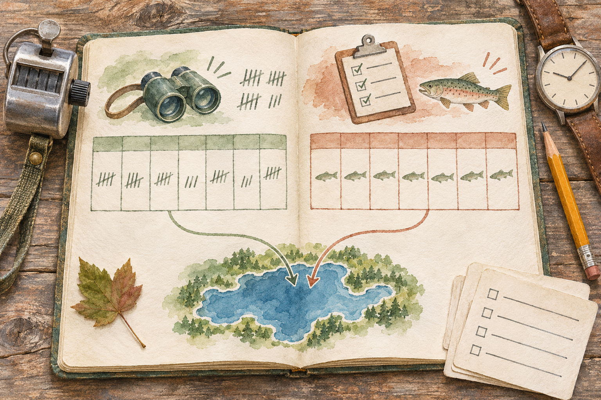
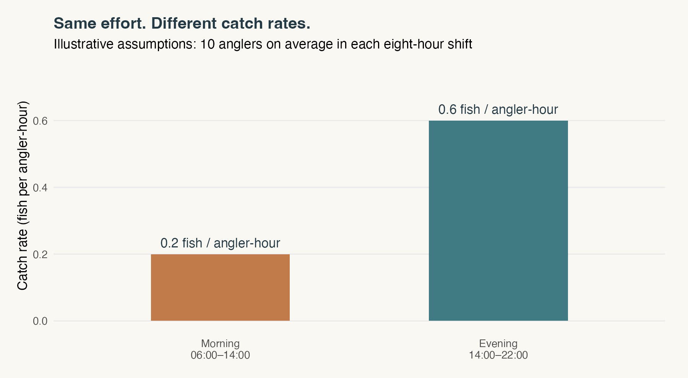
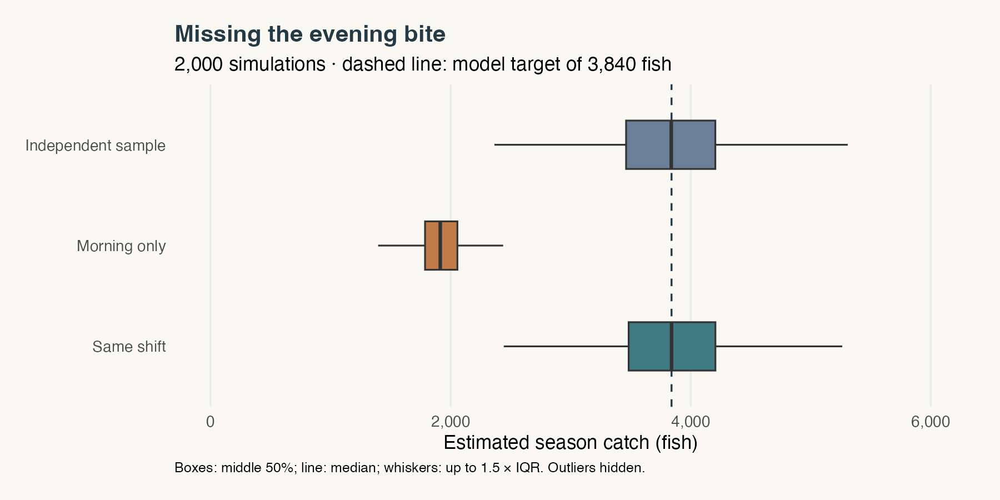
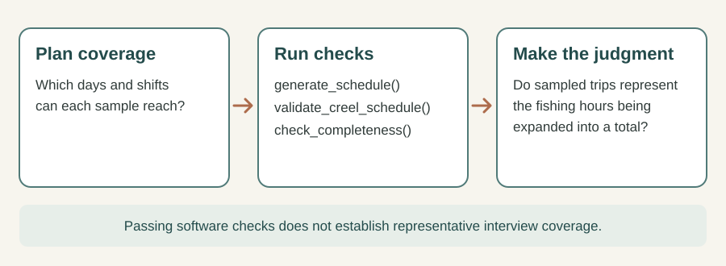

{fig-alt="Overhead watercolor illustration of a field notebook. One page shows angler count tallies, another shows interview records, and separate arrows lead from both pages to the same lake." fig-cap="Counts and interviews can follow different field schedules when both represent the fishing population being estimated. Illustration generated with ChatGPT."}

Does the clerk have to interview anglers on the same days, or in the same shift,
as the effort counts? Staffing rarely lines up neatly. A count might be
scheduled for the evening while the clerk available for interviews works
mornings, or interviews might happen on days with no count at all.

**Counts and interviews can use separate schedules**, provided both samples
represent the fishing population used in the estimate. The estimates need
compatible reporting domains, not necessarily identical sampling strata. Giving
both datasets the same stratum label does not make a morning-only interview
sample represent an evening fishery.

The [catch-totals post](/posts/2026-10-02-catch-harvest-release.html) combined
effort and catch rates within strata. Here I use a small simulation to look at
the field decision behind that calculation: which fishing trips do the
interviews actually cover?

> **In brief**
>
> - Counts estimate effort; interviews estimate catch per angler-hour.
> - Separate schedules can work when both samples represent the same stratum.
> - Interview coverage and sampling weights must match the fishing being
>   estimated.
> - In this constructed example, morning-only interviews recover about half the
>   target catch, despite producing relatively consistent estimates.

## Two estimates, one stratum

For the instantaneous-count design considered here, total catch combines two
estimated quantities, computed within each stratum and then summed:

$$
  \hat{C} = \sum_h \hat{E}_h \times \hat{R}_h
$$

**A stratum** is a group of days, places, or fishing activities analyzed
together, such as June weekdays at one lake. Here, $\hat{E}_h$ is fishing effort
in stratum $h$ (angler-hours, from counts) and $\hat{R}_h$ is the catch rate
(fish per angler-hour, from interviews). The two come from different parts of
the field work, and nothing in the formula asks them to come from the same day.

The creel literature treats that separation as normal. Pollock and colleagues
describe *complemented surveys*, in which effort and catch rate come from
different methods altogether: aerial counts for effort over a large water, say,
with catch rates from access-point interviews ([Pollock et al.
1997](https://doi.org/10.1577/1548-8675(1997)017%3C0011:CREFRA%3E2.3.CO;2)).
That supports using different observation methods; it does not make any
convenient interview schedule representative.

## What sampling theory adds

The population catch rate is a ratio of totals: all fish caught divided by all
angler-hours in the reporting domain. For completed access-point trips, a
weighted sample counterpart is

$$
  \hat R_h = \frac{\sum_{i \in s_h} w_i c_i}{\sum_{i \in s_h} w_i l_i},
$$

where $c_i$ is trip catch, $l_i$ is trip angler-hours, and $w_i$ reflects the
trip’s inclusion probability. With equal weights this reduces to the code’s
`sum(fish) / sum(hours)`. This use of inverse-probability weights follows
[Horvitz and Thompson (1952)](https://doi.org/10.1080/01621459.1952.10483446).
Their unbiased-total result does **not** make a ratio of estimated totals
exactly unbiased.

Ratio estimators generally have finite-sample bias ([Lohr
2022](https://doi.org/10.1201/9780429298899), section 4.1.2; [Lumley
2010](https://doi.org/10.1002/9780470580066), section 5.1.1, pp. 84–85).
Consequently, independent sampling alone does not guarantee an exactly unbiased
catch total. It removes the covariance between independently constructed
estimates; it does not remove bias in the rate itself.

Here, **independent** describes how the samples are drawn. Under design-based
inference, the season’s population values are held fixed and the sampling
randomization supplies the uncertainty ([Lumley
2010](https://doi.org/10.1002/9780470580066), section 1.1.1, pp. 1–2; [Lohr
2022](https://doi.org/10.1201/9780429298899), sections 2.9–2.10). If the two
sampling processes are independent and each estimate uses only its own sample
and fixed design information, their estimates are independent, even if some
dates overlap by chance. Deliberately excluding count days from the interview
draw makes the draws dependent instead.

That conclusion is conditional on the fixed population. If we model different
seasons, shared weather or other random conditions can introduce additional
dependence. Paired field schedules can also create design dependence. These are
different sources of covariance and should not be conflated.

[Goodman (1960)](https://doi.org/10.1080/01621459.1960.10483369) gives the exact
variance of a product under independence and the more general case when
independence does not hold. Zero covariance alone is insufficient for the exact
independent-product variance formula. A same-day design needs an uncertainty
calculation that respects its joint sampling process; moving interviews to
different dates is not a substitute for specifying that process.

## What does have to hold

Three conditions matter more than matching the clerk’s count and interview
times:

1. **Both samples support the same reporting domain.** For the design-based
   approach here, relevant sampling units need known, positive inclusion
   probabilities. Counts and interviews can use different frames and strata,
   provided their estimates are aligned before multiplication.
2. **The interview plan gives the relevant trips a chance of selection.** A
   realized sample need not contain every hour. But a morning-only plan gives
   evening-only trips no chance at all. Reweighting the morning trips cannot
   repair that coverage gap without additional modeling assumptions ([Lohr
   2022](https://doi.org/10.1201/9780429298899), sections 1.3.4 and 15.2.1).
3. **The units match.** Fish per angler-hour times angler-hours. A rate per
   party-hour times angler-hours is a different number.

These requirements follow the probability-sampling and weighting principles in
[Statistics Canada’s *Survey Methods and Practices*, chapters
6–7](https://www150.statcan.gc.ca/n1/pub/12-587-x/12-587-x2003001-eng.pdf).
Weights must also address the actual stages of selection and, where needed,
nonresponse. Sampling 15 trips per shift does not give equal trip probabilities
when different shifts contain different numbers of eligible trips. Interviews
per day should therefore be roughly proportional to that day's fishing, or each
interview should be weighted by eligible trips over trips interviewed; otherwise
a busy day counts no more than a quiet one ([Lohr
2022](https://doi.org/10.1201/9780429298899), section 7.2.2).

The uncertainty calculation must also follow those stages. If 300 interviews
come from 20 sampled days, calculate uncertainty using the sampled days and the
trips selected within them. Treating all 300 trips as a simple random sample of
the season ignores that design ([Lohr
2022](https://doi.org/10.1201/9780429298899), section 5.3; [Lumley
2010](https://doi.org/10.1002/9780470580066), section 3.1.2, pp. 41–42).

The [sampling-calendar post](/posts/2026-09-03-sampling-calendar.html) explains
the first condition. The [interview-method
post](/posts/2026-09-11-roving-interviews.html) explains why completed
access-point trips and incomplete roving trips need different rate estimators.
The example below isolates the second condition.

## A simulation: an evening bite

All numbers below are illustrative assumptions, not observations from a fishery.
Consider one stratum of 60 days. The fishing day runs from 06:00 to 22:00 and is
split into a morning and an evening shift of 8 hours each. Effort is the same in
both shifts, about 10 anglers at any moment, but the evening bite is three times
the morning one: 0.6 fish per angler-hour against 0.2.

{fig-alt="Illustrative catch rates of 0.2 fish per angler-hour in the morning and 0.6 in the evening. Both eight-hour shifts have 10 anglers present on average." fig-cap="The example holds effort equal while making the evening catch rate three times the morning rate."}

The intended count design selects 20 of the 60 days by simple random sampling.
On each selected day, one shift is drawn at random with probability 0.5, and
anglers are counted at a random moment in it. The day's effort is the count
times the shift length, divided by 0.5, the chance that shift was the one drawn.

Catch rates come from 15 completed-trip interviews per sampled day, each with
one angler fishing for one to five hours entirely within a shift. Each plan has
300 interviews. Trips within the sampled shifts have equal selection
probabilities, so the rate is total reported fish divided by total interviewed
angler-hours. We compare three plans:

- **Same shift**: interviews in the shift that was counted.
- **Morning only**: interviews always in the morning, whichever shift was
  counted.
- **Independent sample**: interviews in 20 shifts drawn independently of the
  count shifts, with morning and evening equally likely.

The model has no date-specific fishing conditions, cross-shift trips, or
nonresponse. It generates counts and interview catches separately rather than
building a finite population of trips. The benchmark is therefore the model’s
**expected season catch**, not a realized census total. Independent interview
days could follow this model, but the code does not assign calendar dates.

You can [download the complete R
example](/assets/code/tidycreel_counts_interviews.R){download="tidycreel_counts_interviews.R"}
to reproduce the simulation, table, and figures. The simulation uses base R; the
figures require `ggplot2`. It does not require `tidycreel`.

```r
set.seed(426)
n_days_season <- 60   # days in the stratum
n_sampled     <- 20   # days with a count
shift_hours   <- 8    # morning 06-14, evening 14-22
anglers_mean  <- c(morning = 10, evening = 10)    # anglers present, on average
rate_true     <- c(morning = 0.2, evening = 0.6)  # fish per angler-hour

catch_target <- n_days_season * sum(anglers_mean * shift_hours * rate_true)

# Ratio-of-means catch rate from completed trips in the given shifts
interview_rate <- function(shifts, per_day = 15) {
  shift <- rep(shifts, each = per_day)
  hours <- runif(length(shift), 1, 5)
  fish  <- rpois(length(shift), rate_true[shift] * hours)
  sum(fish) / sum(hours)
}

one_season <- function() {
  # Counts: one shift drawn per sampled day at p = 0.5
  count_shift <- sample(names(anglers_mean), n_sampled, replace = TRUE)
  counts      <- rpois(n_sampled, anglers_mean[count_shift])
  effort_hat  <- n_days_season * mean(counts * shift_hours / 0.5)

  rates <- c(
    "Same shift"   = interview_rate(count_shift),
    "Morning only" = interview_rate(rep("morning", n_sampled)),
    "Independent sample"   = interview_rate(
      sample(names(anglers_mean), n_sampled, replace = TRUE)
    )
  )
  effort_hat * rates
}

sims <- t(replicate(2000, one_season()))

data.frame(
  interviews = colnames(sims),
  mean_estimate = round(colMeans(sims)),
  percent_of_target = round(100 * colMeans(sims) / catch_target, 1),
  sd = round(apply(sims, 2, sd)),
  row.names = NULL
)
```

## What the simulation shows

The target is **3,840 fish**: 60 days × 80 angler-hours per shift × (0.2 + 0.6)
fish per angler-hour. With seed 426 and 2,000 repetitions, the example produces:

  | Interview plan     | Mean estimated catch (fish) | Percent of target | SD across simulations (fish) |
  | :--                | --:                         | --:               | --:                          |
  | Same shift         |                       3,850 |            100.2% |                          549 |
  | Morning only       |                       1,920 |             50.0% |                          201 |
  | Independent sample |                       3,849 |            100.2% |                          562 |

{fig-alt="Horizontal box plots from 2,000 simulations. Same-shift and independent interview samples center near the 3,840-fish target. Morning-only interviews center near 1,920 fish and have a narrower spread." fig-cap="Spread across repeated simulations is not a confidence interval for an individual survey. Boxes show the middle half of estimates; the dashed line marks the model target."}

The same-shift and independent plans both center near the target. Their spreads
are similar **under these assumptions**. This does not show that moving
interviews to different days always has no cost: the model deliberately omits
day-to-day changes in effort and catch rates. Equal count distributions in both
shifts also make the effort estimate independent of the selected shift labels in
this particular model. The same-shift result therefore does not test what
happens when sharing shifts creates dependence.

The morning-only plan averages half the target. Its estimates vary from run to
run, but less than those from the other plans. A narrow spread can therefore
accompany a badly biased estimate. The effort calculation is unchanged; the
problem is applying a morning rate to a day that includes an evening bite.

Making shift a stratum would expose an evening cell with effort but no rate. It
would not supply the missing interviews. Sampling evening trips would let us
estimate an evening rate and multiply it by evening effort.

Equal effort in both shifts is doing useful work here. If shifts have unequal
effort, a pooled rate must reflect those effort shares. Stratifying by shift and
summing the products is one way to handle that difference, provided both shifts
have adequate samples. A correctly weighted pooled estimator can also work;
different effort levels do not automatically require new strata.

In a real survey, standard errors must follow the sampling stages described
above; these box plots show variation under the constructed model and do not
test confidence-interval coverage.

## What separation is fine, and what is not

  | Situation                                           | What to check                                                                                                              |
  | :--                                                 | :--                                                                                                                        |
  | Interviews on days with no count                    | Both sampling plans must support the same reporting domain.                                                                |
  | An interview just after a count shift ends          | Check the trip’s fishing period and its inclusion in the interview sampling plan; the clock time alone does not settle it. |
  | Independently drawn count and interview samples     | Preserve each sample’s probabilities and check the independence assumption used for uncertainty.                           |
  | Interviews only in the slow or fast part of the day | The rate may not represent the full day; extend coverage or narrow the reporting target.                                   |
  | Interviews from another season or day type          | A shared label cannot justify applying a rate from a different population.                                                 |
  | A count outside the shift selected for counting     | Check the count’s actual sampling probability before expanding it.                                                         |

Counts estimate the fishing effort represented by their sampling times.
Interviews estimate rates for the fishing represented by their sampled trips.
Neither observation can be reassigned to a convenient stratum just to make the
tables join.

## In tidycreel

**Separate interview-day support is available now in the development version and
is planned for CRAN in the next release, 9.0.** The [development
notes](https://chrischizinski.com/tidycreel/dev/news/) describe
`creel_design(interview_sampled = )`: a logical column in the full calendar
marks the separately sampled interview days. An interview on a day with no count
can then be accepted; an interview on an unmarked interview day is still
refused. This option is not for bus-route or ice designs, where interviews also
supply the effort data.

To use the development version before that release:

```r
# install.packages("pak")
pak::pak("chrischizinski/tidycreel")
```

The calendar still describes the full reporting period. Keep count-day and
interview-day indicators separate; do not mark an interview-only day as a count
day to get it past validation. `estimate_total_catch()` combines effort and
rates within strata, and the independent-product variance assumption still needs
to fit the survey.

Several planning and checking functions help make the field plan visible.
`generate_schedule()` draws sampled days and, when requested, shifts;
`validate_creel_schedule()` checks that a schedule has valid fields and values.
After data collection, `check_completeness()` can flag scheduled count days
without counts and strata with fewer interviews than a chosen threshold.
`validate_design()` compares proposed sample sizes with precision targets based
on pilot inputs. These functions answer different questions, and none
establishes that the interviews cover the fishing represented by the counts.

The estimators do catch the coarsest version of the gap. A catch total refuses
a stratum that has counted effort but no catch rate, rather than leaving its
fishing out of the total, and in the development version a catch rate pooled
across strata refuses a stratum that was fished but has no usable interviews.
Both work at the level of whole strata. Neither compares, within a stratum, when
the counted fishing happened with when the interviewed trips fished, so a
morning-only interview plan on a lake with an evening bite still produces a
total. A newer check for that gap is described below.

{fig-alt="A three-step workflow moves from planning count and interview coverage, through tidycreel schedule and completeness functions, to judging whether sampled trips represent the fishing hours in the total. A note says passing software checks does not establish representative interview coverage." fig-cap="Use tidycreel to plan and check what was scheduled and collected. Deciding whether the interview sample represents the target fishery still requires a review of the sampling plan."}

For a schedule-derived calendar with shift boundaries and recorded clock times,
the development version rejects a count more than 15 minutes outside the worked
shift by default. Without a declared separate interview sample, an interview
outside that window raises a warning rather than an error. With
`interview_sampled` declared, the count-shift interview check is skipped: the
interview schedule can legitimately differ. These checks depend on the calendar
and time information supplied to the design.

The 15-minute tolerance is a data check, not permission to change the sampling
plan. Nor does passing the checks establish representative coverage. A clerk who
interviews only during the first hour of every selected shift may still miss
fishing that occurs later, without triggering an off-shift warning.

### Checking coverage within a stratum

**`check_interview_coverage()` is available now in the development version and
is planned for CRAN in the next release, 9.0.** It compares the fishing the
counts measured with the fishing the interviewed trips did, stratum by stratum
and hour by hour, in two layers:

- **The plan.** Given the interview periods (the same `periods` table passed to
  `generate_schedule()`) and the fishing day, it marks the hours no clerk could
  have interviewed in. A trip that ended then had no chance of selection, and no
  weighting of the trips that were interviewed can stand in for it. This layer
  can establish a gap.
- **The data.** It compares the anglers counted in each hour with the hours the
  interviewed trips fished in it, and reports the share of counted effort that
  fell in hours with no interviewed fishing. This layer can only point to a
  gap: in a small sample an hour can be missed by chance under a plan that
  covers it.

It needs clock times: the count times (`count_time_col` in `add_counts()`) and
each interview's `trip_start` and `interview_time`. Anything it cannot judge, an
hour with no count or interviews with no clock time, is reported as unknown,
never as covered. It changes no estimate; it is a report to read before
reporting a total.

The example below follows the simulation: a 60-day stratum with 20 sampled
days, counts through the day with a busier evening, and every interview taken
during the morning shift.

```r
library(tidycreel)

set.seed(426)
calendar <- data.frame(
  date = as.Date("2026-06-01") + 0:59,
  day_type = "weekday"
)
sampled <- sort(sample(calendar$date, 20))

# Counts across the whole fishing day; the evening is busier
counts <- data.frame(
  date = rep(sampled, each = 4),
  day_type = "weekday",
  count_time = rep(c("08:00", "12:00", "16:00", "20:00"), 20),
  anglers = rpois(80, rep(c(10, 10, 14, 14), 20))
)

# Interviews of completed trips, all taken during the morning shift
trip_end <- as.POSIXct(paste(rep(sampled, each = 15), "06:00"), tz = "UTC") +
  runif(300, 2, 8) * 3600
hours <- runif(300, 1, 4)
interviews <- data.frame(
  date = rep(sampled, each = 15),
  day_type = "weekday",
  catch = rpois(300, 0.2 * hours),
  hours = hours,
  status = "complete",
  party = 1,
  trip_start = trip_end - hours * 3600,
  interview_time = trip_end
)

design <- creel_design(calendar, date = date, strata = day_type)
design <- add_counts(design, counts, count_col = anglers, count_time_col = count_time)
design <- add_interviews(design, interviews,
  catch = catch, effort = hours, trip_status = status, n_anglers = party,
  trip_start = trip_start, interview_time = interview_time
)

# The plan included both shifts...
check_interview_coverage(
  design,
  periods = data.frame(period_id = 1:2, start_time = c("06:00", "14:00"), end_time = c("14:00", "22:00")),
  fishing_hours = c("06:00", "22:00")
)
```

```
── Interview coverage by time of day ───────────────────────
Blocks of 60 minutes, per stratum; complete trips.

weekday (300 interviews):
  Plan: 0 h of the fishing day not interviewable (0% of counted effort)
  Data: 59% of counted effort in blocks with no interviewed fishing
```

The plan gave evening trips a chance, so the plan layer finds no gap. The data
layer does: 59% of the counted effort fell in hours that no interviewed trip
fished. The plan was not followed, or the evening interviews were never
entered.

```r
# ...or the plan itself was morning-only
check_interview_coverage(
  design,
  periods = data.frame(period_id = 1, start_time = "06:00", end_time = "14:00"),
  fishing_hours = c("06:00", "22:00")
)
```

```
weekday (300 interviews):
  Plan: 8 h of the fishing day not interviewable (59% of counted effort)
  Data: 59% of counted effort in blocks with no interviewed fishing
```

Now the plan layer establishes the gap: eight of the sixteen fishing hours could
not be interviewed, and they hold 59% of the counted effort. A rate from these
interviews describes morning trips only. The remedy is in the field (interview
in the evening) or in the report (narrow the target to the morning), not in the
software.

Before separating the schedules, write down which trips the interview sample
will represent and how those trips receive their sampling weights. Then check
whether the rate applies to the hours, places, and anglers covered by the effort
estimate. Matching the two calendars is optional; answering that question is
part of the survey design.

## What this means in practice

If staffing forces counts and interviews onto different days, the survey can
still produce a useful catch estimate. Plan both samples around the fishing you
want the final number to describe. For example, a lake with morning and evening
fishing needs interviews that can represent both periods, even if counts are
made on other dates.

The costly mistake is a gap that looks tidy in the data. Morning-only interviews
may yield a stable-looking catch rate, but that rate cannot describe an evening
bite the clerks never sampled. A software check can catch missing records; it
cannot supply the missing anglers.

Before reporting a total, ask: **Could every important kind of fishing have
entered the interview sample, and do the weights reflect its chance of being
sampled?** If the answer is no, collect interviews in the missing periods or
report a narrower result that the observed trips can support.

## Supporting literature

- Horvitz, D. G., and D. J. Thompson. 1952. [A Generalization of Sampling
  Without Replacement from a Finite
  Universe](https://doi.org/10.1080/01621459.1952.10483446). *Journal of the
  American Statistical Association* 47:663–685. See pp. 667–670 for inclusion
  probabilities and unbiased totals.
- Goodman, L. A. 1960. [On the Exact Variance of
  Products](https://doi.org/10.1080/01621459.1960.10483369). *Journal of the
  American Statistical Association* 55:708–713. See equations 2, 5, and 18 for
  product variance and its estimation.
- Lohr, S. L. 2022. [*Sampling: Design and
  Analysis*](https://doi.org/10.1201/9780429298899). 3rd ed. CRC Press. Sections
  1.3.4 and 15.2.1 (undercoverage), 2.9–2.10 (design- and model-based
  inference), 4.1 (ratio estimation and its bias), 5.3 (two-stage sampling), and
  7.2.2 (self-weighting samples).
- Lumley, T. 2010. [*Complex Surveys: A Guide to Analysis Using
  R*](https://doi.org/10.1002/9780470580066). Wiley. Sections 1.1.1 (pp. 1–2,
  fixed-population inference), 3.1.2 (pp. 41–42, multistage sampling), and 5.1.1
  (pp. 84–85, ratio estimation).
- Statistics Canada. 2010 [originally 2003]. [*Survey Methods and
  Practices*](https://www150.statcan.gc.ca/n1/pub/12-587-x/12-587-x2003001-eng.pdf).
  Catalogue 12-587-X. Chapters 6–7 cover probability samples, multistage
  designs, weights, and variance estimation.
- Pollock, K. H., J. M. Hoenig, C. M. Jones, D. S. Robson, and C. J. Greene. 1997.
  [Catch Rate Estimation for Roving and Access Point
  Surveys](https://doi.org/10.1577/1548-8675(1997)017%3C0011:CREFRA%3E2.3.CO;2).
  *North American Journal of Fisheries Management* 17:11–19. Connects the
  general estimation principles to creel contact methods.
